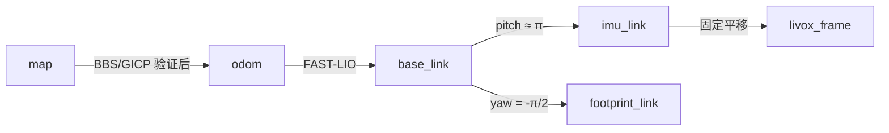

# mapping_nav2 引用链与定位坐标核对

核对入口是 `rc_bringup/launch/mapping_nav2.launch.py`，复用文件而不修改旧入口。

| 配置来源 | 实际约定 | 新定位入口的处理 |
|---|---|---|
| `urdf/reality/model.xacro` | `base_link → imu_link`：零平移，pitch=3.1415926 | TF 读取 `T_base_sensor`，不把 IMU 系直接当成底盘系 |
| 同上 | `imu_link → livox_frame`：平移 [-0.011,-0.02329,0.04412] m，旋转为单位阵 | 与 FAST-LIO 的 LiDAR-in-IMU 外参一致 |
| 同上 | `base_link → footprint_link`：平移 [-0.195,0.183,0] m，yaw=-π/2 | RViz 初值针对 base_link；不能直接当成 footprint_link 初值 |
| `config/reality/fast_lio.yaml` | `mapping.extrinsic_T/R` 与上述 IMU→LiDAR 关系一致，关闭在线外参估计 | 新入口只覆盖发布体扫描与禁止保存地图等参数 |
| `fast_lio/src/laserMapping.cpp` 的 `publish_frame_body()` | 去畸变后执行 LiDAR→IMU 变换，发布 `imu_link` 中的扫描 | BBS 输入 `/cloud_registered_body`；不重复加雷达外参 |
| 同文件 `publish_odometry()` | `/Odometry` 和动态 TF 都是 `odom → base_link` | 按扫描时间插值，再乘 `T_base_sensor` 得到传感器运动 |
| 同文件世界扫描发布与 PCD 保存 | 世界扫描和保存点经过 published-odom alignment | `/cloud_registered` 不能当作局部传感器输入；当前代码的保存约定也不能独自证明既有 1.pcd 的历史来源 |
| `livox_ros_driver2/src/lddc.cpp` 的 `InitImuMsg()` | IMU frame 为 livox_frame，加速度乘 9.81 后发布 | 输入单位已是 m/s²，不再乘 9.81；只用旋转将加速度转入 imu_link |



使用的变换关系为：

```text
T_odom_sensor = T_odom_base * T_base_sensor
T_map_odom = T_map_sensor * inverse(T_odom_sensor)
T_map_base = T_map_sensor * inverse(T_base_sensor)
```

FAST-LIO 的 odom 启动对齐会重置完整姿态，不能从它的单位初始四元数推断绝对重力。新节点仍使用经过静止检查的原始 IMU。1.pcd 不包含可信的重力元数据，因此保留 YAML 中的 +Z/-Z 显式双假设，不根据安装倒置直接固定地图方向。

## 本轮诊断证据

`tf_probe_before_map_optimization/` 保留了调整地图预处理前的四组诊断：法线筛选地图/完整地图 × BBS 门限 0.65/0.45，预算均为 3000 ms。这些是诊断配置，未写入生产默认。

历史扫描 bag_0_13 在筛选地图、门限 0.65 下得到一个候选，覆盖率 0.9403、RMSE 0.1799 m，搜索约 881 ms；它没有位姿真值，也未经过连续新帧验证。降低至 0.45 后出现更多局部质量合格的候选，搜索未完成。新录制的 bag_2_297/594 在筛选地图、门限 0.65 下仍无候选；使用完整地图时能得到局部质量合格的候选，但全局搜索超时。另两份历史单帧只有 16/32 个 BBS 结构点，低于要求的 40。

这些结果支持继续检查结构筛选、可见范围与歧义，不能证明 TF 是唯一原因，也不能证明某个局部候选就是机器人的准确位置。

## 冷地图预处理优化

原实现对约 112 万原始地图点逐点做邻域滤波，然后才降到约 5400 点。最终实现先统计各体素的原始点数量：当体素对角线小于滤波半径，且体素内点数足够时，该体素每个点的邻域支持就已得到证明；只对剩余稀疏点执行原始点 KD-tree 查询。保留原始点顺序，在滤波后才求体素平均值。扫描输入仍按原流程处理，质量覆盖率分母保持全部有效源点。`map_filter_voxel_support: false` 可以恢复旧路径，验证配置中有同版本对照组。

曾尝试直接对降采样地图做滤波、以及查询体素质心的原始邻域，两种方式都只通过严格合成测试的 5/6，已弃用；临界的非地面比例可能受滤波/质心数值变化影响。最终采用原始点滤波与点序一致的加速方式，并增加随机点云上与旧滤波结果逐点比较的回归。首次弃用尝试保存在 `reduced_density_filter_attempt/`。最终结果以同目录 `SUMMARY.md`、`benchmark.csv` 与 `ros_validation.json` 为准，原会话结果保存在 `before_map_optimization/`。耗时都是本机单轮测量，不能解释成稳定的 P95 冷启动或实机准确率。
